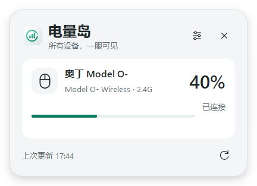

# 电量岛 · ChargeDock（奥丁鼠标版）

一个安静的 Windows 托盘电量工具：只做一件事——显示奥丁（Glorious）无线鼠标的电量。
单个托盘图标，点击在右下角展开临时窗口；电量数字可常驻在托盘图标和任务栏里。

基于 [yszyszysz233/2.4G-battery-viewer](https://github.com/yszyszysz233/2.4G-battery-viewer) 的
Windows HID 底层开发，奥丁（Glorious）鼠标协议参考 korkje/mow 与 Wireless-Device-Battery-Monitor。
代码来源、参考版本与许可证说明见 [ATTRIBUTION.md](ATTRIBUTION.md) 与 [LICENSING.md](LICENSING.md)。



## 本分支说明

基于 [SgZincanya/ChargeDock（电量岛）](https://github.com/SgZincanya/ChargeDock) 的个人修改版，
只面向自己的 Glorious Model O- Wireless：

- 新增奥丁 / Glorious 无线鼠标电量协议（`glorious_proto.py`、`glorious_probe.py`、[GLORIOUS.md](GLORIOUS.md)）
- 托盘图标直接显示百分比，另有任务栏内常驻数字浮标（`tray_percent` / `badge` 两个开关）
- **移除** ROG 鼠标/键盘协议与赛睿耳机协议（`rog_proto.py`、`read_headset`、`parse_headset` 全部删除）
- **移除** 奥创（Armoury Crate）电量浮窗控制，只保留登录自启（`startup.py`）
- 设备卡片按实际检测结果显示：没插接收器时不留空卡片

来源、参考版本与许可证状态见 [ATTRIBUTION.md](ATTRIBUTION.md)、[LICENSING.md](LICENSING.md)；
上游未声明统一许可证，本仓库原样保留该说明。改动清单见 [CHANGELOG.md](CHANGELOG.md)。

## 使用

双击 `ChargeDock.exe`，不需要安装 Python。再次运行只会打开已有窗口，不会再创建图标。

- 左键托盘图标：展开或收起电量窗口。
- 托盘图标可直接显示电量数字，任务栏里另有常驻数字浮标（设置里可分别关闭）。
- 点击窗口外、按 Esc 或超过设定时间：自动收起；鼠标停在窗口内时不会自动关闭。
- 右键托盘图标：打开设置、立即刷新、暂停提醒 30 分钟或退出。
- 设置立即保存；浅色/深色外观跟随 Windows 应用主题。
- 内置简体中文、日语、英语、韩语，默认跟随系统；设置页可即时切换语言。
- 可选开机启动，默认关闭。启用后请保持 EXE 路径不变。

## 支持的设备

| 型号 | 接口 | 显示 |
| --- | --- | --- |
| Glorious Model O- Wireless | 2.4G 接收器 `258A:2024`（本机实测）/ 直连 `258A:2013` | 百分比、充电状态 |
| Glorious Model O Wireless | 接收器 `258A:2022` / 直连 `258A:2011` | 同上 |
| Glorious Model D Wireless | 接收器 `258A:2023` / 直连 `258A:2012` | 同上 |
| Glorious Model D- Wireless | 接收器 `258A:2025` / 直连 `258A:2014` | 同上 |

只有这几款（协议相同）。**不支持蓝牙**，也不支持 ROG、罗技、雷蛇等其它品牌。
没插接收器/数据线时界面不会留下任何设备卡片，只显示一行“未检测到设备”。
协议细节、诊断探针与改型号方法见 [GLORIOUS.md](GLORIOUS.md)。

## 唤醒后自动更新

- 鼠标闲置 20 秒后的首次活动，或已知离线的鼠标首次活动，会在约 0.65 秒后补读电量。
- 只根据设备活动通知判断，不读取、保存或分析按键内容。连续操作不会不断刷新；重复通知会合并，正在读取时会等待完成再补读。
- 接收器重新插上、电脑从睡眠恢复时自动补读。打开窗口时，若距上次更新超过 10 秒，也会补读。
- 读取失败后按 5、10、20、40、80、160 秒递增重试，之后最多每 300 秒一次；读取成功后恢复设置中的正常刷新间隔。
- 这里根据设备活动判断可能的唤醒，不能直接获知固件内部的睡眠状态。

## 低电量提醒

- 阈值可调 1–99%，默认 20%，可单独关闭提醒。
- 电量小于或等于阈值时显示一次 Windows 通知，不强行打开电量窗口。
- 同一次低电量状态不会在每轮刷新时重复提醒。开始充电，或电量恢复到阈值以上 5 个百分点后，才重新允许提醒。
- 充电中、未连接、无效电量和读取失败不会触发提醒。
- 提示音默认关闭，可在设置中开启；Windows 自身通知和勿扰设置仍由系统控制。
- 程序重启后，若鼠标仍处于低电量，会在首次成功读取后提醒一次。

## 常驻电量

- 托盘图标可以直接显示百分比（多尺寸 16–48px，按 DPI 选档），低于阈值转红，未知电量显示 `—`。
- 另有一个数字浮标贴在**任务栏条内部**、通知区域（时钟/托盘图标）左侧，随托盘图标增减自动跟随；
  点一下展开电量窗口，右键出菜单，滚轮立即刷新。
- 两者都在设置里单独开关，默认开启。全屏应用在前台时浮标自动让位，不覆盖游戏画面。

## 稳定性与数据

界面进程不直接进行 HID 读写。读取在独立子进程中运行，超过 9 秒会结束本次读取并保留上次电量，标注“上次读取”，避免设备无响应拖住窗口。

只在本机读取设备，没有联网、遥测或上传。刷新间隔默认 60 秒，可调 30 秒、1 分钟、2 分钟、5 分钟。

每轮 HID 接口只枚举一次并共享结果，下一轮重新枚举，避免跨轮路径缓存失效。协议通信保持串行，面板与托盘不会同时读同一只鼠标。优化测量和打包范围见 [PERFORMANCE.md](PERFORMANCE.md)。

设置保存在 `%LOCALAPPDATA%\ChargeDock\settings.json`。正常读取的中间文件在使用后清除。开机启动设置只在用户手动切换时更改。

## 源码与构建

想改显示名称、加同类接收器的 PID、或调提醒逻辑，请先阅读 [适配指南](ADAPTATION.md)。
新增语言及界面文案见 [语言接口说明](LOCALIZATION.md)。

Windows 64 位，Python 3.11：

```text
python -m venv .venv
.venv\Scripts\python -m pip install -r requirements.txt
.venv\Scripts\python -m unittest discover -p "test_*.py" -v
.venv\Scripts\python -m PyInstaller --noconfirm ChargeDock.spec
```

本机诊断（只发只读电量命令，不改任何设置）：

```text
.venv\Scripts\python glorious_probe.py
```

`assets/app.svg` 是可编辑的原创矢量图标，`app.png`、`app.ico` 是导出文件。界面符号也由 SVG 路径绘制。

## 来源

- Windows HID 底层：[yszyszysz233/2.4G-battery-viewer](https://github.com/yszyszysz233/2.4G-battery-viewer)。
- 奥丁（Glorious）协议参考：[korkje/mow](https://github.com/korkje/mow)、
  [krisgfx9/Wireless-Device-Battery-Monitor](https://github.com/krisgfx9/Wireless-Device-Battery-Monitor)。

完整引用和固定版本链接见 [ATTRIBUTION.md](ATTRIBUTION.md)。第三方运行库说明见 [THIRD_PARTY_NOTICES.txt](THIRD_PARTY_NOTICES.txt)，测试范围见 [VALIDATION.md](VALIDATION.md)。
